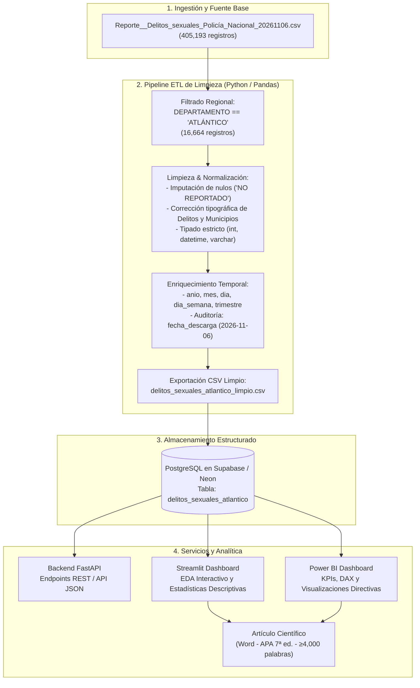

# AGENTS.md — Contexto Maestro del Sistema para Agentes de IA

> **PUNTO DE ENTRADA OBLIGATORIO:** Este archivo define el mapa completo del sistema, la arquitectura, el flujo de datos, las reglas técnicas y los protocolos para cualquier agente de IA que opere en este repositorio.

---

## 📌 Identidad del Proyecto

| Campo | Valor |
|---|---|
| **Proyecto** | Minería de Datos y Analítica Predictiva: Delitos Sexuales en el Departamento del Atlántico (2010–2026) |
| **Fuente de Datos** | Policía Nacional de Colombia — Portal Nacional de Datos Abiertos (`datos.gov.co`) |
| **Fecha de Extracción / Descarga** | **2026-11-06** (Fija e inmutable en metadatos de auditoría) |
| **Población Objetivo** | Registros de delitos sexuales circunscritos al **Departamento del Atlántico** (23 municipios) |
| **Volumen de Datos** | 405,193 registros a nivel nacional ➡️ **16,664 registros limpios para el Atlántico** |
| **Entregables Académicos** | 1. Artículo Científico (Word, ≥4.000 palabras, ≥15 refs APA 7ª ed. ≤3 años) <br>2. BD PostgreSQL en Supabase / Neon (Script SQL DDL) <br>3. EDA interactivo en Python + Streamlit <br>4. Dashboard interactivo en Power BI (`.pbix`) <br>5. Dataset original y procesado <br>6. Evidencias fotográficas |
| **Fecha Límite de Entrega** | **23 de Noviembre de 2026** |

---

## 🗺️ Mapa de Componentes y Módulos

```
mineria_delitos_sexuales_policia_nacional/
├── backend/                  → API REST (FastAPI) + Scripts ETL de Limpieza y Carga a Supabase
│   ├── app/                  → Aplicación FastAPI (endpoints REST para Power BI / Front)
│   ├── scripts/              → Scripts de transformación, limpieza y carga batch
│   ├── AGENTS.md             → Reglas de backend y FastAPI
│   └── README.md             → Guía de ejecución del backend
├── analytics/                → Dashboard EDA y Minería de Datos con Streamlit
│   ├── app.py                → Aplicación interactiva Streamlit
│   ├── pages/                → Secciones temáticas (Temporal, Geográfico, Tipología, Modelos)
│   ├── utils/                → Módulos auxiliares de visualización y estadísticas
│   ├── AGENTS.md             → Reglas de Streamlit y EDA
│   └── README.md             → Guía de ejecución de Streamlit
├── frontend/                 → Portal Web de visualización / control complementario
│   ├── AGENTS.md             → Reglas de frontend
│   └── README.md             → Documentación del frontend
├── docs/                     → Documentación técnica, tareas, base de datos y paper
│   ├── tasks/                → Tablero maestro de tareas (MASTER_STATUS.md) y fases
│   ├── architecture/         → Diagramas de flujo y arquitectura del sistema
│   ├── database/             → Esquema DDL PostgreSQL, scripts de migración y diccionarios
│   ├── paper/                → Estructura y redacción del artículo científico (Word / APA 7)
│   ├── powerbi/              → Modelado de datos DAX, medidas y diseño de tableros
│   ├── data_set/             → CSV original inmutable y CSV limpio procesado
│   ├── AGENTS.md             → Contexto de documentación
│   └── README.md             → Índice de documentación
├── AGENTS.md                 → Contexto global del sistema (Este archivo)
└── README.md                 → Resumen general del proyecto
```

---

## 🛡️ Reglas No Negociables y Principios de Integridad

1. **Inmutabilidad del Dataset Original:** El archivo original `docs/data_set/Reporte__Delitos_sexuales_Policía_Nacional_20261106.csv` **NUNCA** se sobrescribe, edita ni elimina. Se toma como fuente base de solo lectura.
2. **Cero Eliminación de Registros en Atlántico:** Ningún registro perteneciente al departamento del Atlántico debe ser eliminado. Las inconsistencias, campos vacíos o valores nulos (como los 113 registros de género o 26 de grupo etario) se tratan mediante técnicas de estandarización e imputación explícita (`NO REPORTADO`), preservando los **16,664 registros íntegros**.
3. **Fecha de Descarga Declarada:** Todos los pipelines y tablas de base de datos deben incluir la columna de auditoría `fecha_descarga_dataset = '2026-11-06'`.
4. **Base de Datos Gestionada:** Almacenamiento en PostgreSQL alojado en Supabase / Neon, con tipos de datos óptimos, claves primarias, restricciones de integridad y partición / indexación eficiente para consultas analíticas.
5. **Consumo Desacoplado para Power BI:** Power BI debe poder consumir los datos procesados directamente mediante conexión directa a PostgreSQL / Supabase o vía endpoints REST del Backend.

---

## 🔄 Diagrama de Flujo del Procesamiento de Información



---

## 📊 Diccionario del Modelo Limpio (`delitos_sexuales_atlantico`)

| Columna | Tipo SQL | Descripción | Regla de Transformación |
|---|---|---|---|
| `id` | `BIGSERIAL PRIMARY KEY` | Identificador único autoincremental | Clave primaria generada |
| `departamento` | `VARCHAR(50)` | Nombre del departamento | Constante: `'ATLÁNTICO'` |
| `municipio` | `VARCHAR(100)` | Nombre del municipio | Normalizado, sin sufijos '(CT)' |
| `codigo_dane` | `VARCHAR(20)` | Código DANE del municipio | Estandarizado con ceros a la izquierda |
| `armas_medios` | `VARCHAR(100)` | Arma o medio empleado | Texto en mayúsculas limpias |
| `fecha_hecho` | `DATE` | Fecha del suceso | Parseado estricto a formato `YYYY-MM-DD` |
| `anio` | `SMALLINT` | Año del hecho | Derivado de fecha (2010 a 2026) |
| `mes` | `SMALLINT` | Mes numérico (1 a 12) | Derivado de fecha |
| `nombre_mes` | `VARCHAR(20)` | Nombre del mes en español | Derivado de fecha |
| `dia` | `SMALLINT` | Día del mes (1 a 31) | Derivado de fecha |
| `dia_semana` | `VARCHAR(20)` | Día de la semana en español | Derivado de fecha |
| `trimestre` | `SMALLINT` | Trimestre del año (1 a 4) | Derivado de fecha |
| `genero` | `VARCHAR(30)` | Género de la víctima | Valores normalizados; vacíos imputados como `'NO REPORTADO'` |
| `grupo_etario` | `VARCHAR(30)` | Grupo etario de la víctima | Normalizado; vacíos imputados como `'NO REPORTADO'` |
| `cantidad` | `INTEGER` | Cantidad de víctimas | Convertido a entero positivo (mínimo 1) |
| `codigo_articulo` | `VARCHAR(30)` | Código del artículo penal | Extraído (ej. `'ARTÍCULO 209'`) |
| `delito` | `TEXT` | Descripción completa del delito | Texto corregido de artefactos de codificación |
| `fecha_descarga_dataset` | `DATE` | Fecha de captura del dataset | Inmutable: `'2026-11-06'` |
| `origen_datos` | `VARCHAR(150)` | Fuente oficial de procedencia | `'Policía Nacional de Colombia - Datos Abiertos'` |
| `creado_en` | `TIMESTAMPTZ` | Timestamp de inserción | `NOW()` |

---

## 👥 Roles de Agentes y Responsabilidades

- **Agent Lead / Senior Architect:** Mantenimiento de la arquitectura, coherencia del repositorio, sincronización de `MASTER_STATUS.md` y diagramas.
- **Data Engineer / Limpieza:** Ejecución del pipeline ETL en Python, validación de integridad (16,664 registros) y generación del CSV limpio.
- **Database Architect:** Creación y mantenimiento de las tablas e índices en PostgreSQL (Supabase/Neon), políticas de acceso e ingestión batch.
- **Fullstack / Backend Developer:** Implementación de endpoints REST en FastAPI para consulta y agregaciones.
- **Analytics Specialist:** Construcción de la aplicación Streamlit para el Análisis Exploratorio de Datos (EDA) con gráficos estadísticos.
- **Academic Researcher / Docs Architect:** Redacción y compilación del artículo científico bajo normas APA 7ª edición (≥4.000 palabras, referencias recientes).

