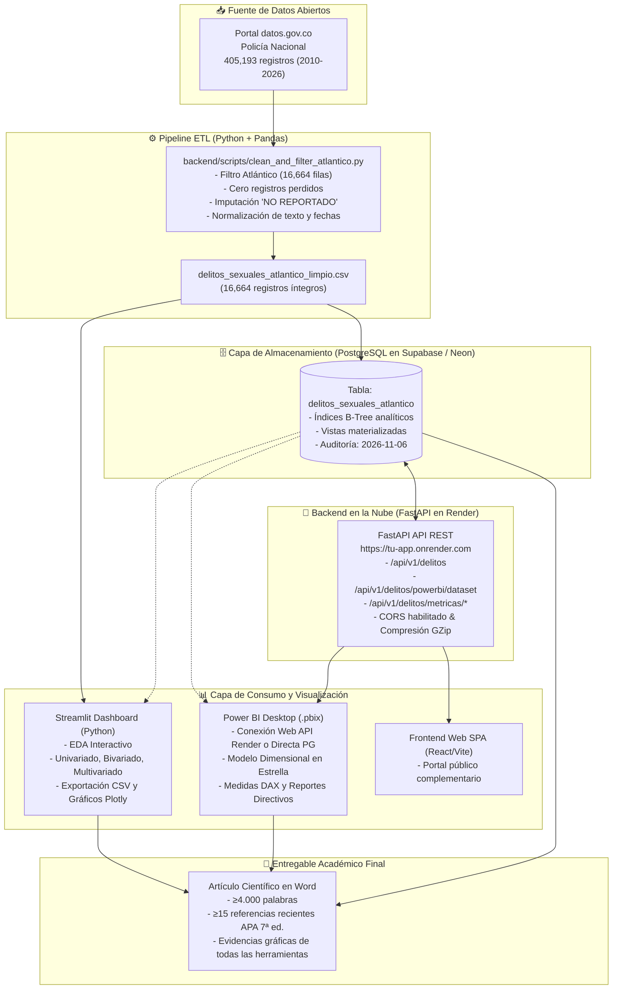
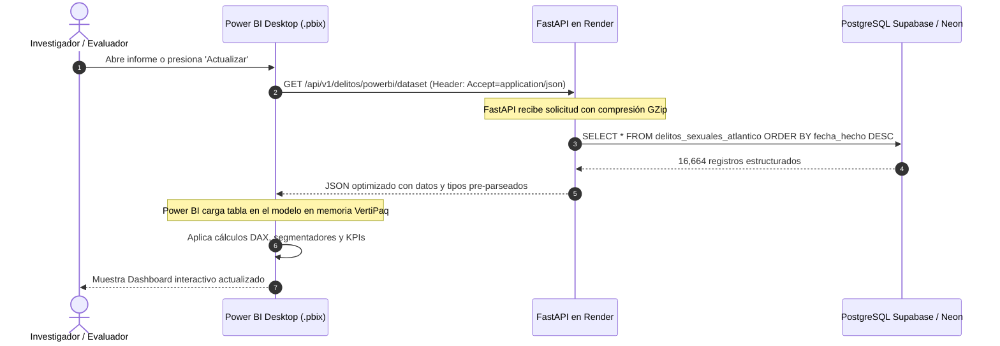
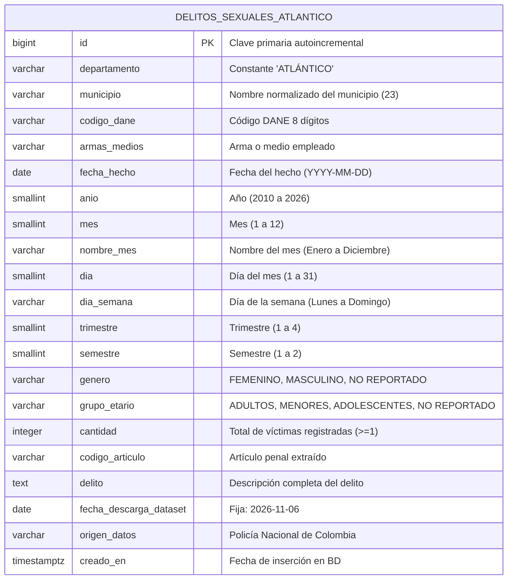

# 🏛️ Arquitectura del Sistema y Flujo de Información

> **Proyecto:** Minería de Delitos Sexuales en el Atlántico (2010–2026)  
> **Plataformas de Despliegue:** FastAPI en **Render**, PostgreSQL en **Supabase / Neon**, EDA en **Streamlit**, Visualización en **Power BI**.

---

## 1. Diagrama de Arquitectura Global

---

## 2. Diagrama de Secuencia: Consumo de Power BI hacia Render

---

## 3. Modelo Entidad-Relación (ERD)

