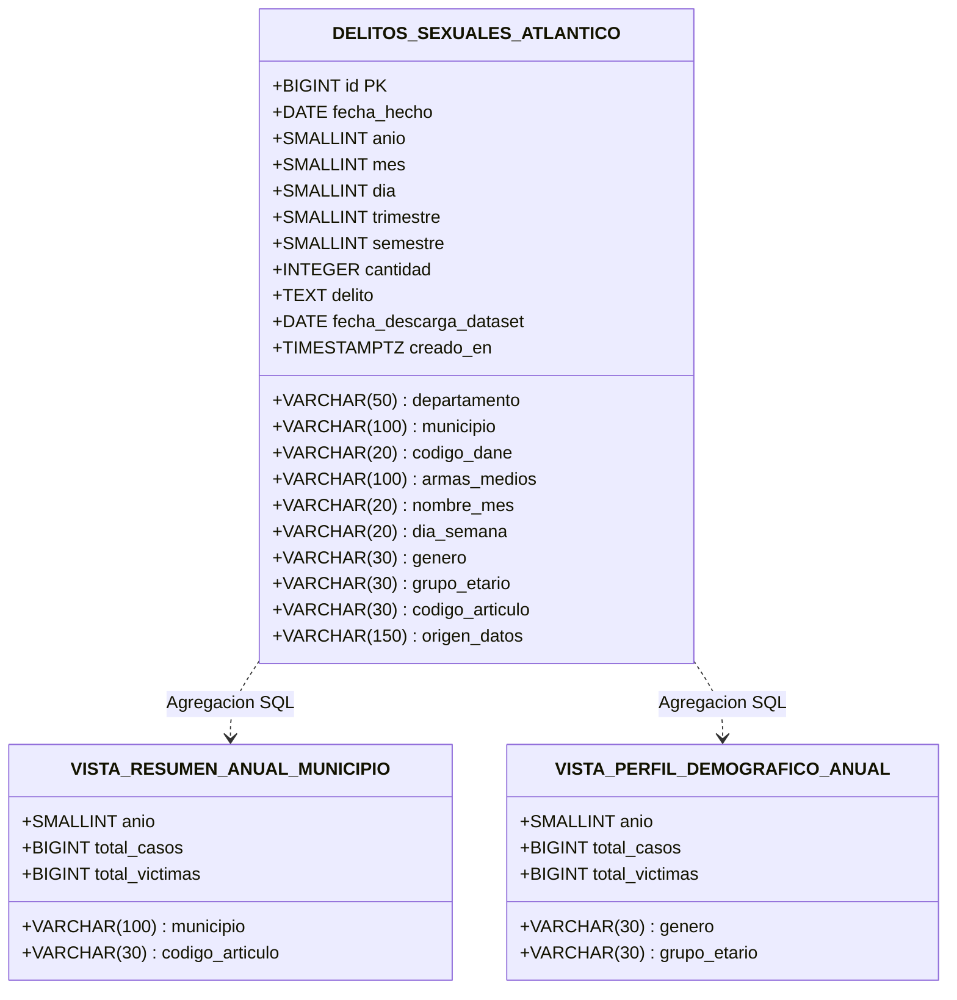

# 🗄️ Documentación de Base de Datos: Esquema Relacional, Índices y Vistas (Supabase / Neon)

> **Motor de Base de Datos:** PostgreSQL 15+  
> **Plataforma Nube:** Supabase / Neon Cloud Database  
> **Script de Creación:** `docs/database/supabase_ddl.sql`  

---

## 1. Diagrama de Estructura de Tablas y Vistas

---

## 2. Diccionario de Datos Físico

| Campo | Tipo SQL | Tamaño / Rango | Nulo | Descripción |
|---|---|---|---|---|
| `id` | `BIGSERIAL` | 1 a 9,223,372,036,854,775,807 | NO | Clave primaria autoincremental única |
| `departamento` | `VARCHAR(50)` | Fijo: 'ATLÁNTICO' | NO | Nombre del departamento administrativo |
| `municipio` | `VARCHAR(100)` | 23 valores únicos | NO | Nombre normalizado de la entidad territorial |
| `codigo_dane` | `VARCHAR(20)` | 8 caracteres numéricos | NO | Código de homologación DANE |
| `armas_medios` | `VARCHAR(100)` | Texto limpio | NO | Arma o método empleado |
| `fecha_hecho` | `DATE` | 2010-01-01 a 2026-12-31 | NO | Fecha exacta de la comisión o denuncia |
| `anio` | `SMALLINT` | 2010 a 2026 | NO | Año cronológico |
| `mes` | `SMALLINT` | 1 a 12 | NO | Mes numérico |
| `nombre_mes` | `VARCHAR(20)` | Texto en español | NO | Nombre del mes calendario |
| `dia` | `SMALLINT` | 1 a 31 | NO | Día del mes |
| `dia_semana` | `VARCHAR(20)` | Lunes a Domingo | NO | Nombre del día |
| `trimestre` | `SMALLINT` | 1 a 4 | NO | Trimestre del año |
| `semestre` | `SMALLINT` | 1 a 2 | NO | Semestre del año |
| `genero` | `VARCHAR(30)` | FEMENINO, MASCULINO, NO REPORTADO | NO | Género de la víctima |
| `grupo_etario` | `VARCHAR(30)` | MENORES, ADOLESCENTES, ADULTOS, NO REPORTADO | NO | Rango etario de la víctima |
| `cantidad` | `INTEGER` | $\ge 1$ | NO | Cantidad de víctimas |
| `codigo_articulo` | `VARCHAR(30)` | Ej: 'ARTÍCULO 209' | NO | Identificador del artículo penal |
| `delito` | `TEXT` | Texto variable | NO | Tipificación textual completa |
| `fecha_descarga_dataset` | `DATE` | '2026-11-06' | NO | Constante inmutable de corte de datos |
| `origen_datos` | `VARCHAR(150)` | Institucional | NO | Entidad de procedencia |
| `creado_en` | `TIMESTAMPTZ` | Timestamp UTC con zona horaria | NO | Fecha de inserción física |

---

## 3. Justificación Técnica de los Índices B-Tree

1. **`idx_delitos_anio_muni (anio, municipio)`**: Optimiza las consultas combinadas más pesadas realizadas por Power BI y filtros cruzados del dashboard.
2. **`idx_delitos_articulo (codigo_articulo)`**: Acelera las búsquedas por tipo de delito y ley infringida.
3. **`idx_delitos_demografico (genero, grupo_etario)`**: Reduce el tiempo de respuesta en tablas de contingencia bivariada.
4. **`idx_delitos_fecha_hecho (fecha_hecho)`**: Permite filtrados eficientes por rangos de fechas (`BETWEEN fecha_desde AND fecha_hasta`).

