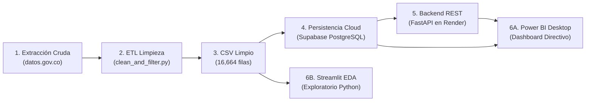

# 🔄 Documento de Arquitectura, Flujo de Datos y Procesos

> **Sistema:** Procesamiento Analítico y Minería de Datos de Delitos Sexuales en el Atlántico  
> **Componentes:** Pipeline ETL (Python), Base de Datos Nube (Supabase PostgreSQL), API REST (FastAPI en Render), Visualización (Power BI y Streamlit)  

---

## 1. Ciclo de Vida del Dato (End-to-End Pipeline)

---

## 2. Descripción de Fases y Protocolos

### Fase 1: Ingestión y Filtrado Regional
1. El script `clean_and_filter_atlantico.py` lee los 405,193 registros con decodificación de caracteres tolerante a fallos.
2. Aplica filtro de contención sobre `DEPARTAMENTO == 'ATLÁNTICO'`.
3. Separa exactamente los 16,664 registros correspondientes a la jurisdicción territorial.

### Fase 2: Imputación de Nulos y Transformación
1. Se aplica la política de Cero Eliminación de registros.
2. Los valores vacíos en `GENERO` y `GRUPO ETARIO` se convierten a `'NO REPORTADO'`.
3. Se normaliza la ortografía y se extrae la codificación del artículo penal.
4. Se generan las 7 dimensiones temporales (`anio`, `mes`, `nombre_mes`, `dia`, `dia_semana`, `trimestre`, `semestre`).
5. Se anexa la auditoría: `fecha_descarga_dataset = '2026-11-06'`.
6. Se almacena el resultado en `docs/data_set/delitos_sexuales_atlantico_limpio.csv`.

### Fase 3: Persistencia en Supabase PostgreSQL
1. El script `upload_to_supabase.py` ejecuta el script DDL `supabase_ddl.sql`.
2. Crea la tabla principal `delitos_sexuales_atlantico` y sus 8 índices B-Tree analíticos.
3. Inserta los 16,664 registros mediante operaciones en bloque (`chunksize=2000`).

### Fase 4: Servicios REST en Render
1. FastAPI se ejecuta en Render mediante el archivo de manifiesto `render.yaml`.
2. Expone el endpoint `/api/v1/delitos/powerbi/dataset` y los endpoints de consulta y agregación.
3. Habilita CORS universal (`*`) y compresión de carga.

### Fase 5: Consumo y Dashboards
- **Power BI:** Conecta a Render vía Web Connector o directo a PostgreSQL Supabase. Modela el esquema en estrella y ejecuta cálculos DAX.
- **Streamlit:** Ejecución local interactiva con 6 pestañas de análisis exploratorio para generación de capturas del artículo científico.

