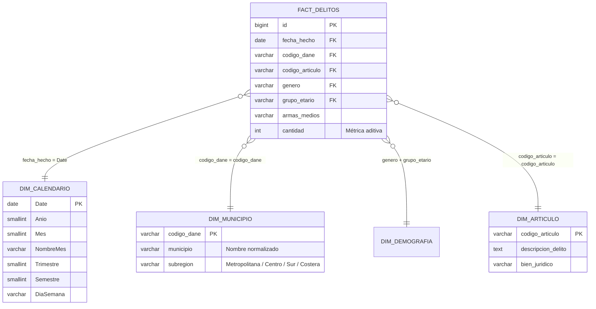

# 📊 Especificación Integral del Tablero en Power BI (.pbix)

> **Proyecto:** Minería de Datos y Analítica Predictiva: Delitos Sexuales en el Atlántico (2010–2026)  
> **Fuente de Datos:** Policía Nacional de Colombia — Portal de Datos Abiertos (`datos.gov.co`)  
> **Fecha de Extracción:** 2026-11-06 | **Población Objetivo:** 16,664 registros limpios  
> **Modos de Conexión:** Endpoint REST de Render (`/api/v1/delitos/powerbi/dataset`) o Conexión Directa a PostgreSQL Supabase  

---

## 🎯 1. Arquitectura del Modelo de Datos (Esquema en Estrella)

Para garantizar el máximo rendimiento del motor **VertiPaq** en Power BI y evitar tablas planas desnormalizadas pesadas, se estructura un modelo dimensional en estrella:



---

## 📐 2. Catálogo Maestro de Medidas DAX

Cree una tabla vacía llamada `_Medidas` en Power BI y agregue las siguientes fórmulas organizadas por carpetas:

### 2.1. Métricas Principales (Volumen y Conteo)
```dax
// Total de hechos registrados
Total Casos = COUNTROWS('Fact_Delitos')

// Total de víctimas involucradas
Total Victimas = SUM('Fact_Delitos'[cantidad])

// Promedio anual de casos
Promedio Anual Casos = 
AVERAGEX(
    VALUES('Dim_Calendario'[Anio]),
    [Total Casos]
)

// Casos en el año anterior
Casos Año Anterior = 
CALCULATE(
    [Total Casos],
    SAMEPERIODLASTYEAR('Dim_Calendario'[Date])
)

// Variación interanual porcentual
Variacion % Interanual = 
DIVIDE(
    [Total Casos] - [Casos Año Anterior],
    [Casos Año Anterior],
    0
)
```

### 2.2. Métricas de Vulnerabilidad y Demografía
```dax
// Total víctimas de género femenino
Victimas Femeninas = 
CALCULATE(
    [Total Victimas],
    'Fact_Delitos'[genero] = "FEMENINO"
)

// Porcentaje de victimización femenina
% Victimas Femeninas = 
DIVIDE([Victimas Femeninas], [Total Victimas], 0)

// Total víctimas menores de 14 años (Niños/Niñas)
Victimas Menores = 
CALCULATE(
    [Total Victimas],
    'Fact_Delitos'[grupo_etario] = "MENORES"
)

// Total víctimas adolescentes (14-17 años)
Victimas Adolescentes = 
CALCULATE(
    [Total Victimas],
    'Fact_Delitos'[grupo_etario] = "ADOLESCENTES"
)

// % Niñez y Adolescencia vulnerada (Menores + Adolescentes)
% Infancia y Adolescencia = 
DIVIDE(
    [Victimas Menores] + [Victimas Adolescentes],
    [Total Victimas],
    0
)
```

### 2.3. Métricas de Concentración Territorial
```dax
// Casos en el Distrito de Barranquilla
Casos Barranquilla = 
CALCULATE(
    [Total Casos],
    'Fact_Delitos'[municipio] = "Barranquilla"
)

// Casos en el Área Metropolitana (Barranquilla + Soledad + Malambo + Galapa + Puerto Colombia)
Casos Area Metropolitana = 
CALCULATE(
    [Total Casos],
    'Fact_Delitos'[municipio] IN {"Barranquilla", "Soledad", "Malambo", "Galapa", "Puerto Colombia"}
)

// Porcentaje de concentración metropolitana
% Concentracion Metropolitana = 
DIVIDE([Casos Area Metropolitana], [Total Casos], 0)
```

---

## 🖥️ 3. Estructura y Diseño de Páginas del Reporte (Tableros)

Se definen **5 páginas temáticas** diseñadas bajo principios de jerarquía visual y análisis de datos:

---

### 📄 Página 1: Resumen Ejecutivo y Centro de Comando Directivo
- **Objetivo:** Proporcionar a directivos y comandantes un vistazo inmediato del panorama delictivo global.
- **Segmentadores Superiores (Filtros):**
  - Slider de Años (2010 a 2026).
  - Selector desplegable de Municipios.
  - Botón de Género (Todos / Femenino / Masculino).
- **Tarjetas de KPIs (Fila superior):**
  1. `[Total Casos]` con etiqueta "Total Hechos Registrados" (Formato: `16.664`).
  2. `[Total Victimas]` con etiqueta "Total Víctimas" (Formato: `16.664`).
  3. `[% Victimas Femeninas]` con tarjeta de llamada (Formato: `85.12%`).
  4. `[% Infancia y Adolescencia]` con tarjeta de alerta roja (Formato: `32.93%`).
  5. `[% Concentracion Metropolitana]` (Formato: `79.2%`).
- **Visuales Principales:**
  - **Gráfico de Líneas con Sombreado:** `[Total Casos]` por `Dim_Calendario[Anio]`. Eje X: Años (2010–2026). Marcadores activados y línea de tendencia analítica.
  - **Gráfico de Donut (Anillo):** Distribución por `genero` (Femenino `#E11D48`, Masculino `#0284C7`, No Reportado `#94A3B8`).
  - **Gráfico de Barras Horizontales:** Top 7 Municipios con más hechos.
  - **Treemap (Mapa de Árbol):** Distribución por `codigo_articulo` (tamaño proporcional al volumen).

---

### 📄 Página 2: Comportamiento Cronológico y Series de Tiempo
- **Objetivo:** Identificar estacionalidad, meses críticos, días pico y variaciones anuales.
- **Visuales:**
  - **Gráfico Combinado (Línea + Columnas Agrupadas):**
    - Columnas: `[Total Casos]` por año.
    - Línea: `[Variacion % Interanual]`.
  - **Matriz de Calor Mensual (Matrix):**
    - Filas: `Dim_Calendario[Anio]`.
    - Columnas: `Dim_Calendario[NombreMes]` (ordenado por Mes 1 a 12).
    - Valores: `[Total Casos]`.
    - Formato condicional: Escala de colores degradada de blanco a rojo intenso para detectar meses atípicos.
  - **Gráfico de Columnas por Día de la Semana:**
    - Eje X: Lunes a Domingo.
    - Valores: `[Total Casos]`.
    - Análisis: Muestra qué días de la semana registran mayor incidencia reportada.
  - **Árbol de Descomposición (Decomposition Tree):**
    - Analizar: `[Total Casos]`.
    - Explicar por: `Anio` ➡️ `Trimestre` ➡️ `Municipio` ➡️ `Grupo Etario`.

---

### 📄 Página 3: Desglose Demográfico y Vulnerabilidad Infantil
- **Objetivo:** Visibilizar los sectores poblacionales más expuestos y las circunstancias de edad.
- **Visuales:**
  - **Pirámide Poblacional / Barras Bivariadas:**
    - Eje Y: `grupo_etario` (Menores, Adolescentes, Adultos).
    - Valores: `[Total Victimas]`.
    - Leyenda / Desglose: `genero`.
  - **Gráfico de Columnas 100% Apiladas:**
    - Eje X: `Dim_Calendario[Anio]`.
    - Eje Y: `100%`.
    - Leyenda: `grupo_etario`.
    - Propósito: Comprobar si la proporción de menores victimizados ha aumentado en la última década.
  - **Tarjetas Indicadoras de Alerta Infantil:**
    - Casos contra Menores de 14 años (Art. 209).
    - Casos de Incesto / Acceso Carnal Violento.

---

### 📄 Página 4: Distribución Territorial y Mapas del Atlántico
- **Objetivo:** Análisis geoespacial de la criminalidad en los 23 municipios.
- **Visuales:**
  - **Mapa de Formas / Mapa de Burbujas de Power BI:**
    - Ubicación: `Dim_Municipio[municipio]`, Atlántico, Colombia.
    - Tamaño de Burbuja: `[Total Casos]`.
    - Color de Burbuja: Saturación según tasa de criticidad.
  - **Tabla Dinámica con Barras de Datos Integradas:**
    - Columnas: `Municipio`, `Código DANE`, `Total Casos`, `% del Total`, `Víctimas Menores`, `Art. Principal`.
  - **Filtro de Subregión:** Botonera para filtrar Área Metropolitana vs Resto del Departamento.

---

### 📄 Página 5: Tipificación Penal y Medios Empleados
- **Objetivo:** Análisis criminológico y legal de los artículos del Código Penal (Ley 599 de 2000).
- **Visuales:**
  - **Gráfico de Barras Horizontales con Top N:**
    - Top 10 artículos penales más transgredidos (`codigo_articulo`).
    - Tooltip enriquecido mostrando la descripción completa del delito.
  - **Gráfico de Donut:**
    - `armas_medios` (Arma blanca, Arma de fuego, Sin empleo de armas, Contundente, etc.).
  - **Matriz Cruzada:**
    - Filas: `codigo_articulo`.
    - Columnas: `grupo_etario`.
    - Valores: `[Total Casos]`.

---

## 🎨 4. Paleta de Colores y Guía de Estilo

Para cumplir con el perfil institucional y directivo:
| Nombre | Código Hexadecimal | Uso en el Dashboard |
|---|---|---|
| **Azul Institucional Policía** | `#1E3A8A` | Encabezados, tarjetas principales, líneas de tendencia |
| **Gris Pizarra Oscuro** | `#0F172A` | Títulos y etiquetas de datos |
| **Fondo Claro Minimalista** | `#F8FAFC` | Fondo de las páginas del informe |
| **Blanco Puro** | `#FFFFFF` | Fondo de las tarjetas y contenedores visuales |
| **Rojo Alerta / Femenino** | `#E11D48` | Énfasis en violencia de género y alertas de menores |
| **Azul Claro / Masculino** | `#0284C7` | Desglose masculino y barras secundarias |
| **Gris Neutro** | `#94A3B8` | Registros no reportados y líneas de cuadrícula |

---

## 🔌 5. Conexión de Datos en Power BI Desktop

### Método A: Conexión vía API REST de Render (Recomendado)
1. Abra Power BI Desktop y seleccione: **Obtener datos ➡️ Web**.
2. Seleccione la opción **Básico** e ingrese:
   ```
   https://api-delitos-sexuales-atlantico.onrender.com/api/v1/delitos/powerbi/dataset
   ```
   *(O en local: `http://localhost:8000/api/v1/delitos/powerbi/dataset`)*
3. En la ventana del Editor de Power Query, pegue el código M disponible en `docs/powerbi/POWERBI_GUIDE.md`.
4. Haga clic en **Cerrar y aplicar**.

### Método B: Conexión Directa a PostgreSQL en Supabase
1. Seleccione: **Obtener datos ➡️ Base de datos PostgreSQL**.
2. **Servidor:** `db.TU_PROYECTO_SUPABASE.supabase.co` (o el host del pooler `aws-0-...pooler.supabase.com`).
3. **Base de datos:** `postgres`.
4. **Modo de conectividad:** **Importar** (para habilitar VertiPaq) o **DirectQuery**.
5. Seleccione la tabla `delitos_sexuales_atlantico` o las vistas pre-agregadas `vista_resumen_anual_municipio`.

