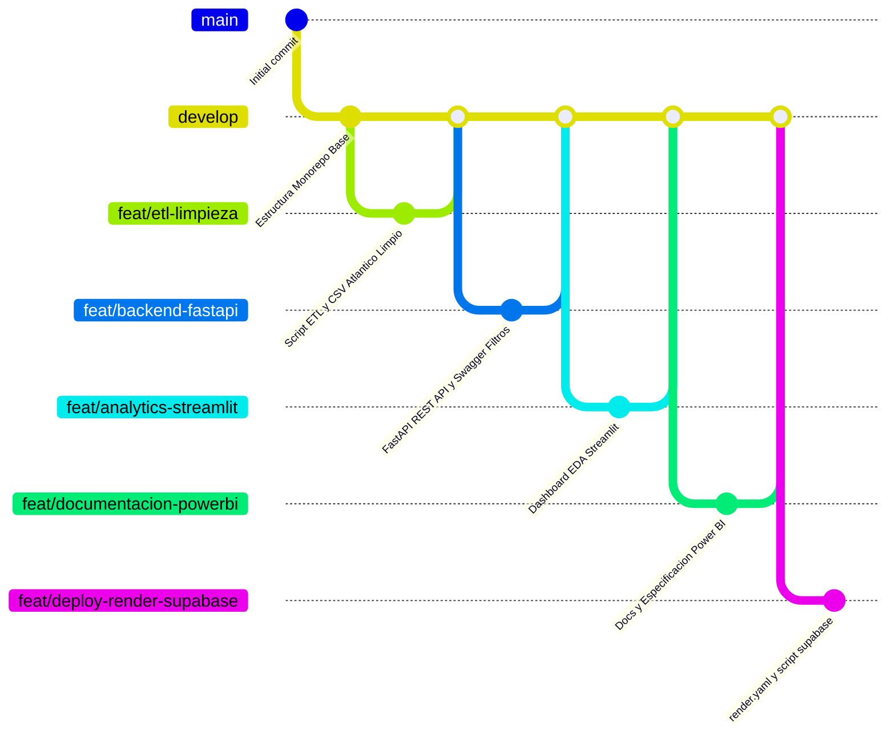

# 📋 ESTADO GENERAL DEL PROYECTO (MASTER_STATUS)

> **ATENCIÓN IA:** Este documento es la única fuente de la verdad para el estado de las tareas del proyecto. Antes de cada commit o tras completar un hito, debes actualizar el estado de los checkboxes de las tareas completadas y reflejar el progreso global aquí.

---

## 📊 Progreso General

- [x] **Fase 1: Ingestión, Limpieza y Pipeline ETL** — *(Completado: Cero pérdida de registros, 16,664 registros limpios filtrados para el Atlántico, imputación de nulos, enriquecimiento temporal y exportación a CSV limpio)*
- [x] **Fase 2: Arquitectura de Base de Datos (PostgreSQL en Supabase)** — *(Completado: Conexión validada con Supabase Pooler en puerto 6543, tabla creada sin ID, 8 índices B-tree creados, Row Level Security (RLS) habilitado con políticas de lectura pública y escritura restringida, y los 16,664 registros limpios cargados exitosamente)*
- [x] **Fase 3: Backend API REST (FastAPI) & Swagger Multidimensional** — *(Entorno `.venv` configurado, modelos ORM, esquemas Pydantic v2, filtros avanzados por fecha, ley, municipio, edad, endpoints `/delitos/filtros/opciones` y `/delitos/powerbi/dataset`, manifiesto `render.yaml` listo)*
- [x] **Fase 4: Análisis Exploratorio de Datos (EDA) en Streamlit** — *(Aplicación interactiva `analytics/app.py` lista con 6 pestañas analíticas, filtros dinámicos, Plotly y descarga CSV)*
- [x] **Fase 5: Especificación y Modelado para Power BI (`.pbix`)** — *(Especificación completa en `docs/powerbi/ESPECIFICACION_POWERBI.md` con 5 páginas detalladas, catálogo DAX, guía de conexión Web M y esquema en estrella)*
- [x] **Fase 6: Portal Web de Documentación (React + Tailwind) & Buenas Prácticas** — *(Portal React 18 + Vite + Tailwind CSS completado con diseño de alta gama sin emojis, diagramas interactivos de Mermaid, consola de pruebas en vivo, catálogo de endpoints, guía de handoff para Power BI y soporte para Vercel)*
- [x] **Fase 7: Despliegue en Render (Multi-Servicio) y Carga a Supabase** — *(Carga batch de 16,664 registros limpios en Supabase con RLS activo; configuración de infraestructura `render.yaml` multi-servicio lista para FastAPI y Streamlit)*
- [ ] **Fase 8: Redacción del Artículo Científico (Formato Word)** — *(Plan estructurado en `docs/paper/PLAN_ARTICULO.md`. Pendiente redacción de las ≥4.000 palabras bajo normas APA 7ª ed. cuando se dispongan las evidencias)*

---

### 🕒 Últimas Actualizaciones (2026-11-06)

- **Swagger & Endpoints:** Ampliado `delitos.py` y `delito_service.py` con filtros por rangos de fechas (`fecha_desde`, `fecha_hasta`), años (`anio_desde`, `anio_hasta`), artículo penal (`codigo_articulo`), búsqueda textual (`delito_buscar`), ordenamiento y endpoint de opciones `/delitos/filtros/opciones`.
- **Power BI:** Creado `docs/powerbi/ESPECIFICACION_POWERBI.md` con la especificación de 5 páginas de reportes, catálogo completo de medidas DAX, código M y modelado en estrella.
- **Render:** Creado `render.yaml` con configuración de infraestructura como código (IaC) para despliegue automático del backend.
- **Documentación Central:** Creada la carpeta `docs/documentacion/` con 5 documentos técnicos sobre decisiones metodológicas, diagramas de BD, catálogo de endpoints, flujo de arquitectura y estándares de ingeniería.
- **README Central:** Actualizado el archivo raíz `README.md` con descripción exhaustiva de carpetas, tecnologías, versiones, comandos y hallazgos.

---

## 🌳 Mapa de Ramas (Git Flow)

---

## 👥 Checklists Detallados por Módulo

1. 🧹 **[Fase 1: Limpieza y Preprocesamiento ETL](fases/01_limpieza_datos.md)**
2. 🗄️ **[Fase 2: Base de Datos PostgreSQL Supabase](fases/02_base_datos_supabase.md)**
3. 📈 **[Fase 3: Aplicación EDA en Streamlit](fases/03_streamlit_eda.md)**
4. 📊 **[Fase 4: Dashboard y Especificación Power BI](fases/04_powerbi_dashboard.md)**
5. 📝 **[Fase 5: Redacción del Artículo Científico (Plan)](fases/05_articulo_cientifico.md)**
6. 📚 **[Directorio de Documentación Técnica](../documentacion/)**
